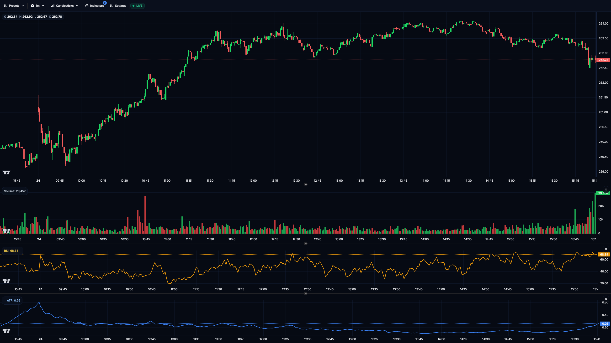
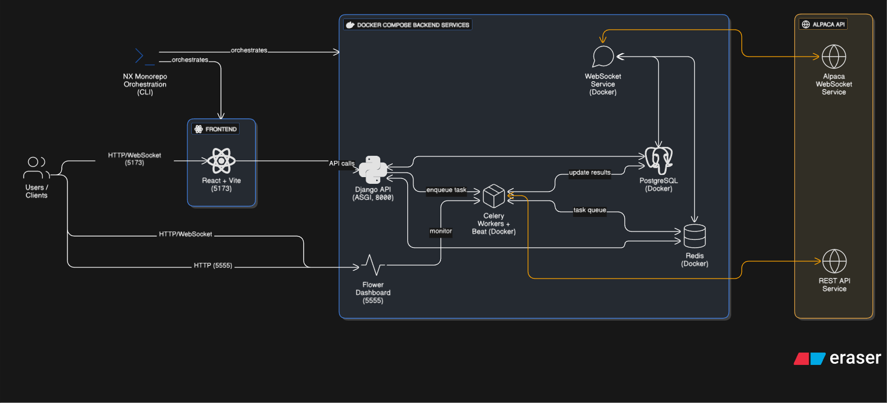

<div align="center">

# Alpaca Main

### Build your market tool. Not the plumbing.

A full-stack, open-source starter for market dashboards, research tools, and trading applications.

[](LICENSE)
[](https://github.com/naveedkhan1998/alpaca-main/stargazers)
[](#under-the-hood)

**[Explore the live demo](https://alpaca.mnaveedk.com)** · **[Run it locally](#quick-start)** · **[Build on it](#make-it-yours)** · **[Report an issue](https://github.com/naveedkhan1998/alpaca-main/issues)**

</div>



You have an idea for a market screener, a research dashboard, or a trading workflow. Before you can build it, you need authentication, watchlists, historical data, streaming, candle storage, background jobs, and a UI.

**Alpaca Main gives you that starting point.** It brings a Django API, React frontend, Alpaca market-data integration, and Dockerized backend services together in one extensible codebase. Fork it, keep what you need, and build the part that makes your project different.

This started as a personal open-source project and unexpectedly became the foundation for real client work. The goal here is still the same: give other developers a useful head start.

**MIT licensed. Free to use, modify, and build commercial products on.**

## What you can build

| Your idea | The head start |
| --- | --- |
| **A personal market terminal** | Watchlists, asset search, interactive charts, and streaming updates |
| **A research or screening tool** | Historical OHLCV storage, multiple timeframes, and background jobs |
| **A strategy research interface** | Chart replay and indicators, with room for your own backtesting engine |
| **A custom trading application** | Accounts, API structure, async workers, and a frontend to extend |
| **A market-data pipeline** | Alpaca ingestion, paginated backfills, PostgreSQL persistence, and Redis caching |

This is a **boilerplate and working reference application**, not a packaged profitable strategy or a turnkey live-trading system. You bring the domain logic, execution controls, and deployment requirements.

## What is already here

- **Charts worth building on.** Candlesticks, volume, historical replay, and configurable indicators including moving averages, RSI, MACD, Bollinger Bands, and VWAP.
- **Your own market workspace.** Search assets, organize watchlists, and explore historical and live data through the React UI.
- **Market-data handling beyond a basic API call.** Paginated history, bounded retries, decimal candle storage, fractional crypto volumes, and automatic SIP-first selection with IEX fallback when SIP access is unavailable.
- **Live candles that can correct themselves.** Timestamp-ordered provisional trade candles are replaced by Alpaca's authoritative minute bars and updated bars. Higher timeframes are rebuilt from stored minutes instead of repeatedly adding snapshots.
- **A foundation for application features.** User accounts, JWT authentication, Django REST Framework endpoints, Django admin, and a paper-trading app to extend.
- **Background work separated from the request path.** Celery workers and Beat scheduling, Redis cache/broker, and a dedicated market-data WebSocket service.
- **A development stack you can inspect.** Docker Compose for backend services, Vite hot reload for the frontend, and Nx commands for development, linting, tests, and builds.

For ingestion details and data-refresh behavior, see the [backend market-data documentation](backend/README.md#market-data-handling).

## Try it before you clone it

**[Open the live demo →](https://alpaca.mnaveedk.com)**

| Access | What you can do |
| --- | --- |
| **Anonymous** | Explore historical charts and example watchlists without signing up |
| **Registered** | Create watchlists, add or remove assets, and use real-time updates |

Anonymous access is read-only, has no live streaming, and is rate-limited to keep the shared demo sustainable. You do **not** need your own Alpaca credentials to try it.

For your own project, run it locally with your own credentials and data subscription.

## Quick start

### 1. Get the prerequisites

- **Node.js 20.19+ or 22.12+** and npm, compatible with the Vite 7 frontend
- **Docker with Docker Compose**, with the Docker daemon running
- **[uv](https://docs.astral.sh/uv/getting-started/installation/)** for backend dependencies; the backend targets Python 3.14+
- **An Alpaca API key and secret** for local market-data access

### 2. Clone and configure

```bash
git clone https://github.com/naveedkhan1998/alpaca-main.git
cd alpaca-main
mkdir -p .envs
```

Create `.envs/.env` with your local configuration:

```dotenv
APCA_API_KEY=YOUR_ALPACA_KEY
APCA_API_SECRET_KEY=YOUR_ALPACA_SECRET_KEY

POSTGRES_DB=alpaca
POSTGRES_USER=postgres
POSTGRES_PASSWORD=CHOOSE_A_LOCAL_DATABASE_PASSWORD
POSTGRES_HOST=postgres
POSTGRES_PORT=5432

REDIS_URL=redis://redis:6379/0
REDIS_CACHE_URL=redis://redis:6379/1
SECRET_KEY=GENERATE_A_RANDOM_SECRET
```

Replace the placeholders before installing. Keep this file private: **never commit API credentials or secrets**. The `postgres` and `redis` hostnames above are for services inside Docker Compose.

Stock data automatically checks SIP entitlement first and uses IEX if Alpaca explicitly denies SIP access. You do not need to configure a feed environment variable. Crypto and option history use their own endpoints; available data still depends on your Alpaca subscription.

### 3. Install and launch

```bash
npm install
npm run dev
```

Installation checks prerequisites and credentials, then installs frontend and backend dependencies. Development runs the Vite frontend locally and starts backend infrastructure in Docker. The backend entrypoint applies migrations on startup.

| Open | Purpose |
| --- | --- |
| [localhost:5173](http://localhost:5173) | Frontend |
| [localhost:8000](http://localhost:8000) | Django backend |
| [localhost:8000/admin/](http://localhost:8000/admin/) | Django admin |
| [localhost:5555](http://localhost:5555) | Flower task monitoring |

**Local-development warning:** the startup script creates a default admin account when the database has no users. Change its credentials before exposing the app. The supplied development configuration is not a hardened production deployment.

## Make it yours

The code is organized so you can extend the application without starting over:

| Where | What to build |
| --- | --- |
| [`frontend/src/features/graphs/`](frontend/src/features/graphs/) | Custom indicators, chart controls, and research views |
| [`frontend/src/features/`](frontend/src/features/) | New screens and feature-specific state |
| [`frontend/src/shared/`](frontend/src/shared/) | Reusable UI components and API integration |
| [`backend/apps/core/services/`](backend/apps/core/services/) | Market-data processing, persistence, and ingestion logic |
| [`backend/apps/core/tasks.py`](backend/apps/core/tasks.py) | Scheduled scans, data jobs, and async workflows |
| [`backend/apps/paper_trading/`](backend/apps/paper_trading/) | Your simulation and paper-trading workflows |
| [`backend/apps/`](backend/apps/) | A new Django app for your own domain logic |

For example: add a scheduled screener in Celery, expose the results through a DRF endpoint, and build a feature page that opens matching assets in the existing chart interface.

Keep private strategies and credentials separate from anything you publish. The infrastructure is reusable; your strategy does not have to be open source.

## Under the hood

| Layer | Tools |
| --- | --- |
| **Frontend** | React, TypeScript, Vite, Redux Toolkit, Tailwind CSS, Radix UI, Lightweight Charts |
| **Backend** | Django, Django REST Framework, JWT authentication, Django Channels |
| **Data** | Alpaca API, PostgreSQL candle storage, Redis caching |
| **Jobs** | Celery workers, Celery Beat, Flower |
| **Development** | Nx, Docker Compose, npm, uv |
| **Quality** | pytest, Vitest, Ruff, Black, ESLint, Prettier |

### How the data flows

```text
Alpaca REST API ──→ Celery historical-data jobs ──┐
                                                ├──→ PostgreSQL + Redis
Alpaca stream ────→ Market-data WebSocket service┘              │
                                                              ↓
                                                   Django API / Channels
                                                              │
                                                              ↓
                                                   React charts + watchlists
```

The ingestion service, API server, workers, and scheduler run as separate services. That makes the project useful both as a starter and as a concrete example of a full-stack market-data application.

<details>
<summary>View the architecture diagram</summary>



</details>

## Everyday commands

Run these from the repository root:

| Command | What it does |
| --- | --- |
| `npm run dev` | Start frontend and backend infrastructure |
| `npm run dev:frontend` | Start only the frontend; expects the backend to be running |
| `npm run dev:backend` | Start backend infrastructure |
| `npm run lint` / `npm run lint:fix` | Check or fix lint issues |
| `npm run format` / `npm run format:check` | Format code or check formatting |
| `npm run test` / `npm run test:coverage` | Run tests, optionally with coverage |
| `npm run build` | Build the frontend for production |
| `npm run makemigrations:local` | Generate Django migrations locally |
| `npm run migrate` | Apply migrations in the backend container |
| `npm run backend:shell` | Open a shell inside the backend container |
| `npm run docker:logs` | Follow service logs |
| `npm run docker:down` | Stop Docker services |

Optional local log monitoring with Vector, Loki, and Grafana:

```bash
docker compose -f docker-compose.yaml -f docker-compose.local.yaml up -d
```

Grafana is available at [localhost:3000](http://localhost:3000). These are local-development services; review their configuration before deploying them.

## Contribute or build something with it

Bug fixes, better onboarding, new indicators, data-handling improvements, and focused tests are all welcome. Open an [issue](https://github.com/naveedkhan1998/alpaca-main/issues) with reproduction steps or a concrete proposal, or send a pull request.

Follow the existing app boundaries and formatting conventions, add tests for behavior changes, and update related documentation. Include screenshots for UI changes.

If this saves you time, **give it a star** so other developers can find it. If you build something public with it, share it in an issue; seeing what people make is the point.

## License and author

Created by **[Naveed Khan](https://github.com/naveedkhan1998)** · [mnaveedk.com](https://mnaveedk.com) · [Contact](mailto:naveedkhan13041998@gmail.com)

Released under the [MIT License](LICENSE). Personal and commercial use are welcome; preserve the required copyright and license notice when distributing the software.

Not affiliated with Alpaca Markets. This is developer tooling, not financial advice. Validate data, test your own logic, and implement appropriate safeguards before using any derived application with real money. Market-data access and redistribution remain subject to your provider's terms.
